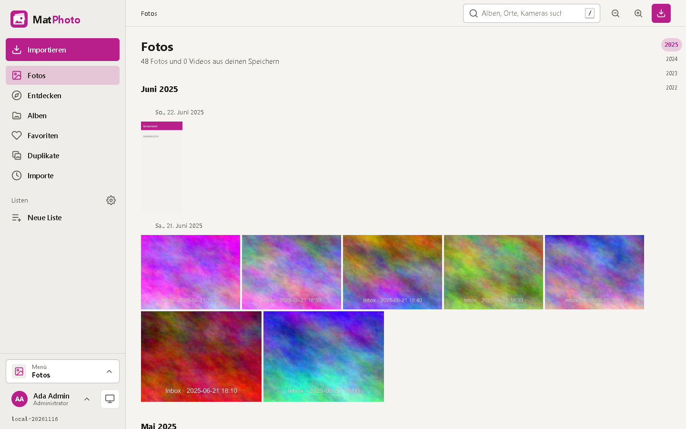
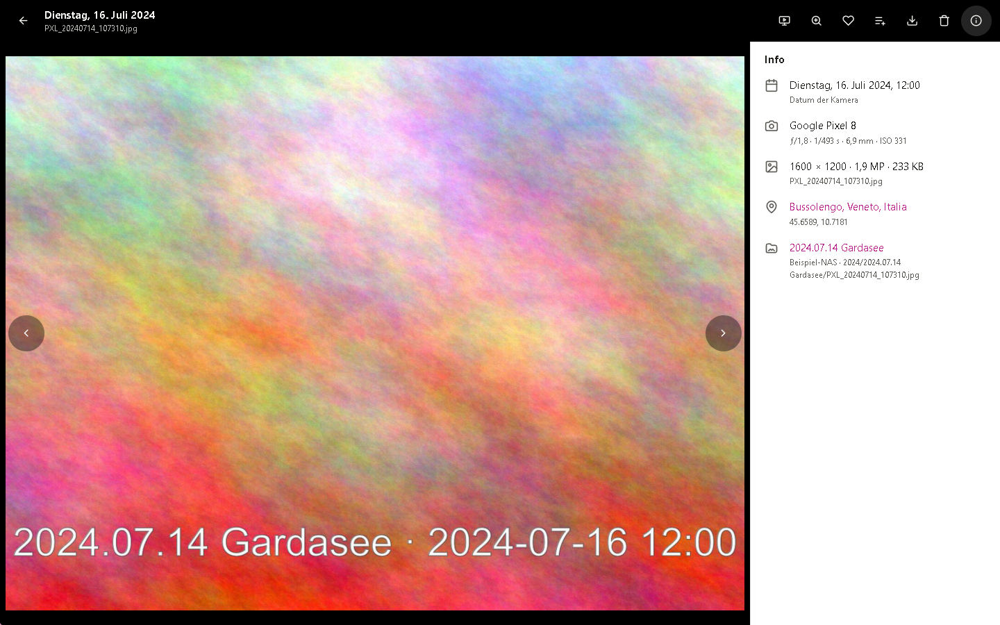
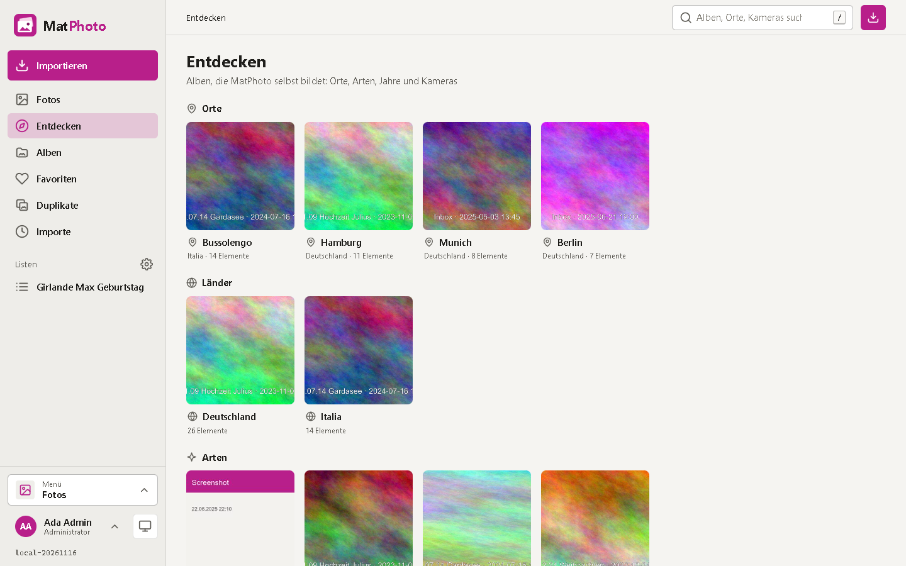
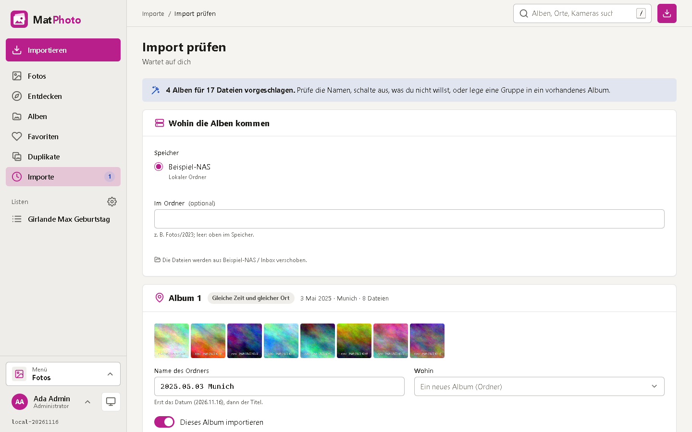
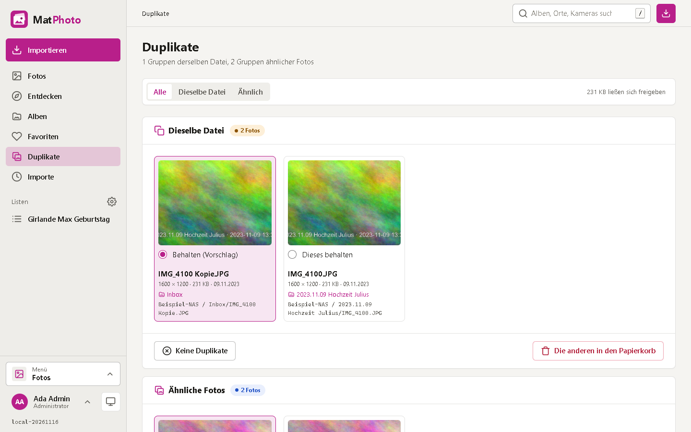
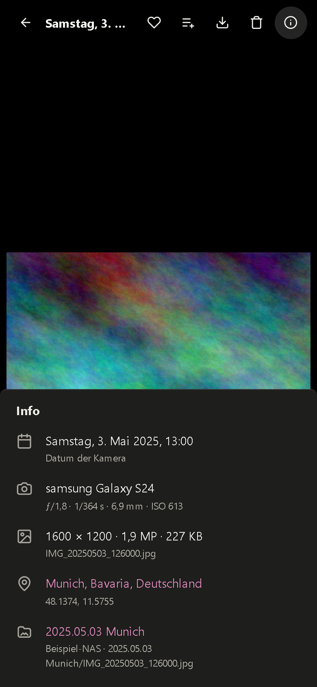

<p align="center"></p>

# MatPhoto

Your photos and videos in the browser – like the photo apps people know – **straight from your own storage**: a folder of the server or a share of your NAS
(SMB, WebDAV, SFTP, FTP). The photos stay where they are; the albums are folders you can read without MatPhoto (`2023.11.09 Hochzeit Julius`). One container plus
PostgreSQL, part of the Mat family.

## What it does

| | |
|---|---|
| **Storages as the library** | Folders of the server and shares of a NAS are scanned and kept in step (new, changed, moved and removed files). Folders a NAS keeps for itself (`@eaDir`, `#recycle` …) are left out. |
| **Albums are folders** | Every folder with photos is an album. A new album makes a folder, renaming it renames the folder, "delete" moves it into `.matphoto-trash` of the storage. |
| **Lists** | Photos of any album put together for a project ("Girlande Max Geburtstag") – links only, shared with everybody if you like. |
| **The grid** | Every photo and video month by month and day by day in justified rows, endless scrolling (only what is near the screen is in the page), a year bar, selection of ranges and whole days. |
| **The viewer** | Full screen on black, the next photos loaded ahead, keys and swipes, zoom, slideshow, videos with seeking, Live Photos, the info (date, camera, exposure, place, album). |
| **Thumbnails and cache** | Made once with ImageMagick (JPEG, HEIC, PNG, WebP, AVIF, TIFF, RAW) and ffmpeg (videos), kept in the data volume or a folder of a storage (your NAS), keyed by the content. |
| **Explore** | Automatic albums: places (found offline from the positions), videos, screenshots, selfies, panoramas, Live Photos, animations, RAW, years, cameras. |
| **Duplicates** | The same file twice and similar pictures (another size, a burst), side by side: keep one, the rest goes into the trash folder. |
| **Smart import** | Upload files or whole folders, or name a folder of a storage (the inbox your phone syncs to): dates, places and duplicates are recognised, albums suggested by time, place and folder, then copied or moved. |
| **PWA** | Installable, works on phones (safe areas, no zoom on fields), the last grids and thumbnails offline. |

| | |
|---|---|
|  |  |
|  |  |
|  |  |

## Run it

```bash
docker compose up -d              # release (branch main)  -> http://localhost:4830
```

The first account that registers is the administrator. Then **Administration → Storages → New storage**:

- a **share of the NAS**: SMB (host, share, user, password), WebDAV (address), SFTP or FTP – the password is kept encrypted;
- or a **folder of the server**: mount it into the container below `/storage` (e.g. `- /volume1/photo:/storage/photo` under `volumes:` of `web`) and choose
  *Local folder* `/storage/photo`.

The first scan starts at once (Administration → Scans shows how far it is). *Administration → System → Thumbnails* chooses where the cache lies (the data volume or
a folder of a storage), *→ Import* how new albums are named and grouped.

| File | Branch / image | Extra |
|---|---|---|
| `docker-compose.yml` | `main` → `:latest` | |
| `docker-compose.dev.yml` | `dev` → `:nightly` | pgAdmin on 4831 |
| `docker-compose.local.yml` | builds this folder | pgAdmin 4831, Postgres 4832, `./sample-data` as `/storage/sample` |

## Development

```bash
dotnet build MatPhoto.slnx                                  # 0 warnings
dotnet run --project tools/SampleData -- sample-data        # 48 sample photos with EXIF, GPS, screenshots, duplicates, an inbox
./scripts/redeploy.ps1                                      # rebuilds and starts the local stack (-Clean: empty volumes)
MATPHOTO_TEST_DB="Host=localhost;Port=4832;Username=matphoto;Password=matphoto;Database=postgres" dotnet test
```

Versions: release `<major>.<minor>.<build>-<date>` (branch `main`), development `nightly-<build>-<date>` (branch `dev`), local `local-<date>`. The workflow
`.github/workflows/build.yml` builds, tests and pushes `ghcr.io/real-ttx/matphoto` for linux/amd64 and linux/arm64.

## The Mat family

MatPhoto speaks the platform contract of the family (MatPlatform 2.4, `/api`): sign-in through **MatIdentity** and mail through **MatSMTP** (both optional,
connected by **Mattiverse** or by their variables), the launcher *Photos* with quick actions, and the widgets *Library* and *Active users* for administrators.
`MAT_PUBLIC_URL` fixes the public address. MatPhoto does its whole job without any variable.

## Not yet

- People (faces) – planned, on the server, without a cloud.
- Transcoding of videos the browser cannot play (HEVC in some browsers, MKV, AVI): they are downloaded instead.
- Sharing albums by link with people without an account.

## Credits

Places: [GeoNames](https://www.geonames.org) (CC BY 4.0), towns of 15,000 people or more, read offline. ImageMagick (Magick.NET), MetadataExtractor, ffmpeg,
SMBLibrary, SSH.NET, FluentFTP, MatUi.
